<p align="center">
  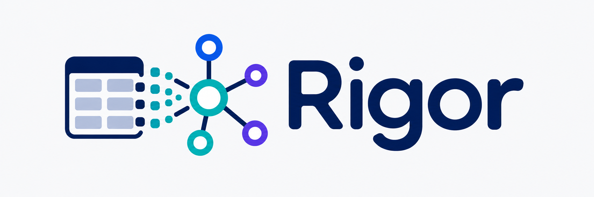
</p>

# RIGOR App

**RIGOR** (*Retrieval-augmented Iterative Generation of RDB Ontologies*) is an
LLM-driven approach that turns relational database schemas into rich OWL 2 DL
ontologies with minimal human effort. Rather than requiring an engineer to model
an ontology by hand, or settling for the bare structure, a direct mapping
produces — RIGOR combines three sources through Retrieval-Augmented Generation
(RAG): the database schema together with its documentation, a repository of
existing domain ontologies, and a growing *core* ontology. It prompts a
generative LLM to produce successive, provenance-tagged "delta" fragments; each
fragment is checked by a judge-LLM before being merged, and the process iterates
table-by-table following foreign-key constraints until the schema is fully
covered.

This repository is the **companion application**: a Gradio interface around the
RIGOR pipeline. You upload a table (CSV) or a SQL schema (JSON), optionally add
documents, a seed core ontology, and external vocabularies, then run enrichment
followed by syntax, consistency, and OOPS! validation. Safe repairs are applied
automatically; semantic changes are presented for user confirmation before the
reviewed ontology and decision report are exported. The app can also validate
and repair an existing RDF/OWL ontology. It is designed to run **locally for a
single user**. For the method and evaluation, see the paper linked at the end of
this README.

## [Demo videos on YouTube](https://www.youtube.com/playlist?list=PLV3vgCoFRQI4)

The *RIGOR APP DEMO* playlist has the walkthrough of the app on the oncology
example (cryptic `BM_DEP` column → bone marrow depression grade, expert review
of OOPS! findings, and the ontology graph).

## Quick start

**What you need**

| What | Needed for | Where to get it |
|---|---|---|
| Python **3.10–3.12** | the app | [python.org](https://www.python.org/downloads/) (check with `python3 --version`; 3.13+ has no PyTorch wheels yet) |
| An **OpenRouter API key** | LLM generation, judging and repair | [openrouter.ai/keys](https://openrouter.ai/keys). Optional: without a key the app runs deterministic Direct Mapping only |
| **Java 11+** | HermiT/ROBOT consistency stage | [Adoptium Temurin](https://adoptium.net/) (macOS: `brew install --cask temurin`; Ubuntu: `sudo apt install default-jre`). Check with `java -version`. Optional: the stage is skipped without it |
| `HermiT.jar` and `robot.jar` | same stage | downloaded in step 3 below |
| **Docker Desktop** | a local OOPS! server | [docker.com](https://www.docker.com/products/docker-desktop/). Optional: only needed if the public OOPS! service is unreachable |

**Install and start**

```bash
# 1. Get the code
git clone https://github.com/NadeenAhmad/RIGOR_APP.git
cd RIGOR_APP

# 2. Create a virtual environment and install the dependencies
python3 -m venv .venv            # use Python 3.10-3.12, e.g. python3.12 -m venv .venv
source .venv/bin/activate        # Windows: .venv\Scripts\activate
pip install -U pip
pip install -r requirements.txt

# 3. Download the reasoner jars next to rigor_app.py (for the consistency stage)
curl -L -o robot.jar https://github.com/ontodev/robot/releases/latest/download/robot.jar
curl -L -o HermiT.zip http://www.hermit-reasoner.com/download/current/HermiT.zip
unzip -j HermiT.zip HermiT.jar && rm HermiT.zip

# 4. Start the app
python rigor_app.py
```

Open the printed address (usually http://127.0.0.1:7860). On Windows, download
the two jars in your browser instead and put `HermiT.jar` (inside `HermiT.zip`)
and `robot.jar` in the `RIGOR_APP` folder.

**First run** (the oncology example from the demo video):

1. In **Settings**, paste your OpenRouter key; the model is preselected.
2. Click **Check OOPS! connection**. If it reports the service unreachable,
   start the local OOPS! server (see *Run* below) or just continue: the run then
   uses local pitfall checks.
3. Open **Optional context (advanced)** and upload the 7 files in
   `examples/oncology_cancer/documentation/` as *Documents* and the 3 files in
   `examples/oncology_cancer/external_ontologies/` as *External ontologies*.
4. Upload `examples/oncology_cancer/schema/oncology_schema.json` and click
   **Run generation pipeline** (about 8 minutes with Gemini Flash).
5. Review the decision card, click **Apply selected decisions**, then
   **Visualize ontology → Visualize last result**.

## Install details

`requirements.txt` includes the full RIGOR stack (sentence-transformers, faiss,
torch) plus Gradio. The torch line is pinned per architecture automatically:
torch 2.2.2 on Intel macOS, any recent torch elsewhere. On Intel macOS pip
therefore also settles on matching `transformers` and Gradio versions (checked
on an Intel Mac with Python 3.10: every package installs from a prebuilt wheel,
nothing is compiled).

The jars are picked up automatically if they sit in the working directory (or
next to `rigor_app.py`); otherwise, enter their paths in the UI. Detection vs.
repair:

- HermiT deterministic fixes and ROBOT reasoning run **without** an API key.
- The actual inconsistency *repair* loop calls the LLM, so it only fixes
  things when an OpenRouter key is set.

If Java or a jar is missing, the stage is skipped with a clear message, and the
ontology is passed through unchanged.

The logo shown in the header is loaded from `rigor_logo.png` next to
`rigor_app.py`; keep the two files together. If the image is missing, the app
falls back to a plain text title.

## Run

```bash
python rigor_app.py
```

Then open the printed local URL. To run against a local OOPS! server instead
of the public one (recommended for demos, and needed while the public service
is down; requires Docker Desktop to be running):

```bash
./oops_local/start_oops.sh
OOPS_ENDPOINT=http://localhost:8080/OOPS/rest python rigor_app.py
```

This app is intended to run **locally for a
single user**; it is not hardened for shared multi-user hosting (the API key
and models are held in session memory, not isolated per user).

## Using the app

1. **Upload** a CSV (types are inferred and a schema is synthesized) or a SQL
   schema JSON.
2. Review the **summary**: rows, columns, detected types, missing values, a
   preview, and any warnings (e.g., no primary key detected).
3. In **Settings**, paste your OpenRouter API key, pick a model, and enable the
   required validation stages.
4. Click **Run pipeline**. Progress streams live with elapsed time and a coarse
   percentage indicator. **Stop** returns control immediately; an in-flight
   model call may finish in the background.
5. If semantic pitfalls remain, review the focused decision cards, approve or
   reject individual axioms, and click **Apply selected decisions**. For missing
   disjointness (P10) and equivalence (P30) a card also has a class-pair picker:
   choose two classes from the ontology and click **Add class pair** to add an
   axiom the LLM did not suggest (see *Decision cards*).
6. **Download** the final or reviewed ontology, inspect the validation report,
   expand the Turtle preview, or render the interactive graph.

To repair an ontology without generating one from a schema, use the
**Repair the existing ontology** section and upload a supported RDF/OWL file.

## Example walkthrough: the case of `BM_DEP`

This is the run shown in the [demo video](https://www.youtube.com/playlist?list=PLV3vgCoFRQI4),
on `examples/oncology_cancer/`: **ONCOREG**, a fictional legacy oncology
database with 8 tables. Its column `ae_tox.BM_DEP INTEGER` means *bone marrow
depression grade* (CTCAE 0–5), but only a 2009 memo and the data dictionary say
so. The example comes with per-table data dictionaries, that memo, and three
small demo vocabularies for adverse events, oncology and clinical terms (all
invented for the demo). See [its README](examples/oncology_cancer/README.md) for
what to point at in the result. Model: Gemini 3.8 Flash; OOPS!: the local
server from `oops_local/`. The resulting ontologies, decision report and graph
are saved in `examples/oncology_cancer/rigor_app_results_gemini/`.

**1. Settings.** The OpenRouter key is masked and kept in memory only; the
model is preselected. The validation stages are on, the jars are found
automatically, and **Check OOPS! connection** confirms the OOPS! server is
reachable.

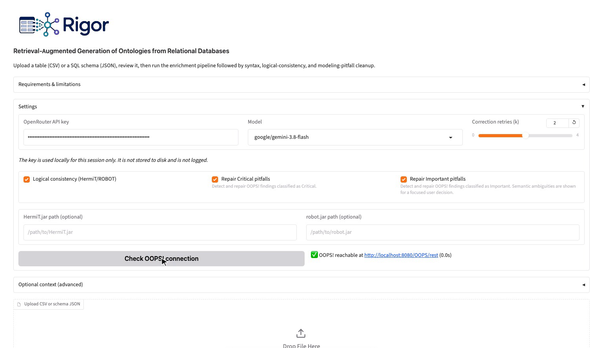

**2. Optional context.** The 7 documents (data dictionaries and the `BM_DEP`
memo) and the 3 external vocabularies are uploaded under *Optional context*.

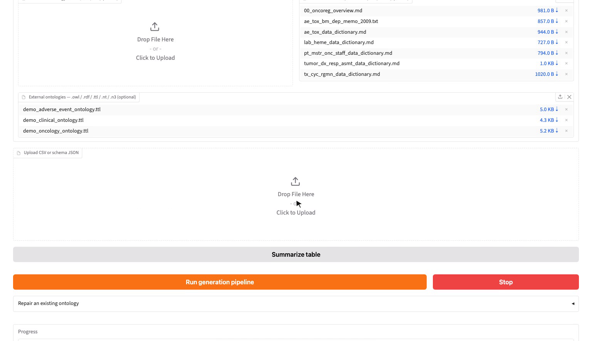

**3. Schema summary.** After `oncology_schema.json` is uploaded, the summary
lists every table and column with keys and references. Nothing in the schema
says what `ae_tox.BM_DEP INTEGER` means.


**4. Generation.** Progress streams live with the elapsed time. For each table
RIGOR retrieves hints from the documents and vocabularies, the Gen-LLM drafts
an ontology fragment, and the Judge-LLM approves it or sends it back.

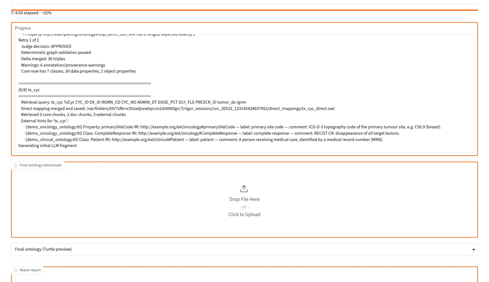

**5. Validation and result.** Syntax normalization, HermiT/ROBOT consistency
and the OOPS! repair loop run next; safe fixes are applied automatically and
the final ontology is offered for download. *Needs your decision* lists the
findings that would change domain meaning.

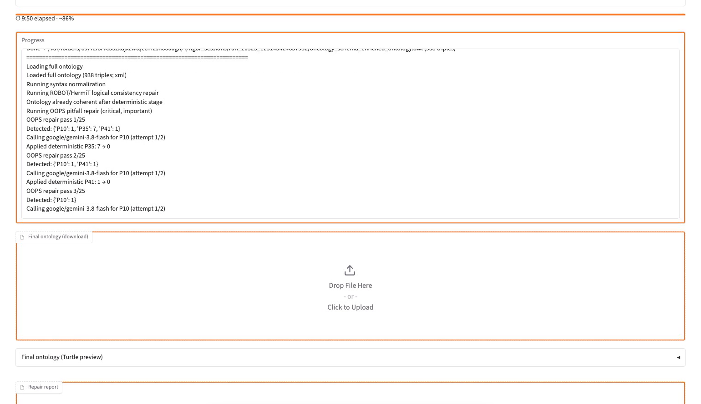

**6. Turtle preview.** Columns become labelled properties with meaning taken
from the documentation (for example *absolute neutrophil count*: "values below
0.5 indicate grade 4 neutropenia"), the original column name as
`skos:altLabel`, `prov:wasDerivedFrom` provenance back to the column, and
alignments such as `lab_heme.HGB` ⊑ `clinical:hemoglobinConcentration`.

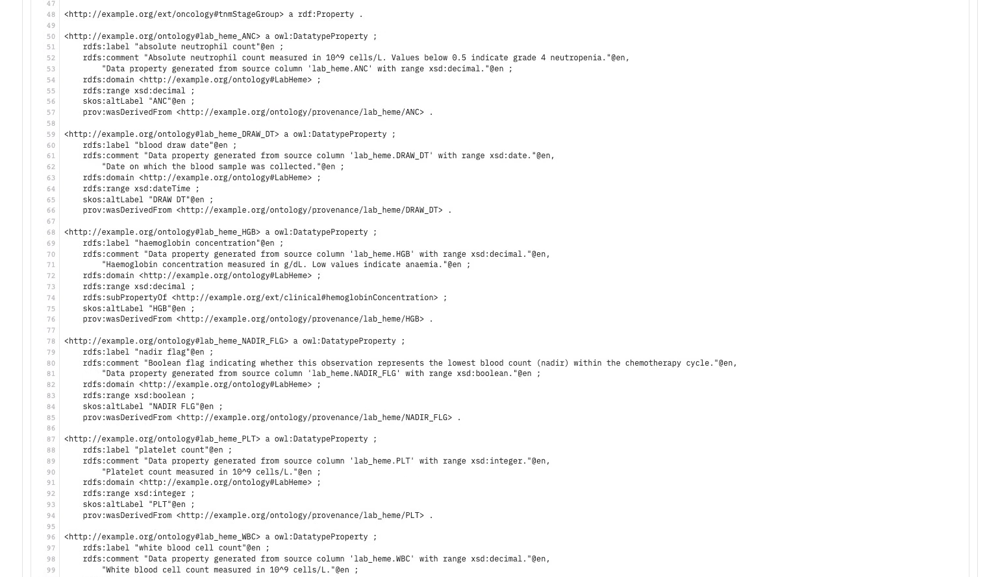

**7. Decision card.** OOPS! reported missing disjointness (P10). The card shows
the evidence and the LLM's suggested pairs to approve individually; here all
15 pairs between the record classes were approved. The class-pair picker adds
pairs the LLM missed: the people classes, e.g. *Cancer Patient* ⟂ *Tumor
Diagnosis*.

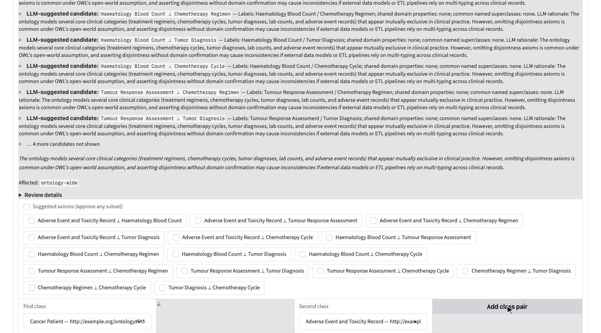

**8. Apply.** The expert-selected pairs are listed with the decision; **Apply
selected decisions** re-validates every change with HermiT and OOPS! and writes
the reviewed ontology and a decision report: "Updated ontology ready … Applied:
1 · Rejected by validation: 0".

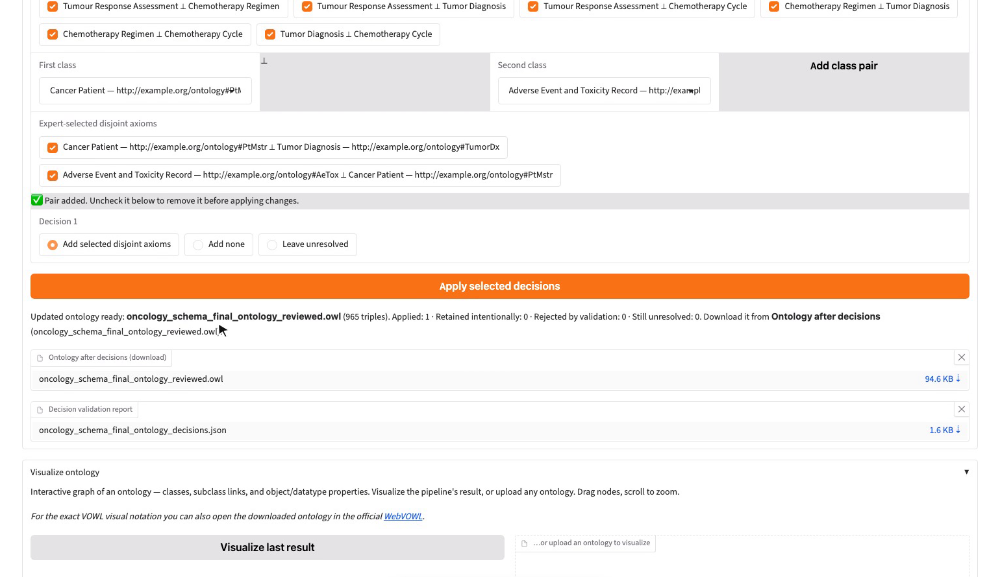

**9. Graph after review.** *Visualize ontology* draws the result; the summary
line reports 17 disjointness axioms, drawn as red links (here *Adverse Event
and Toxicity Record* ⟂ *Haematology Blood Count*).

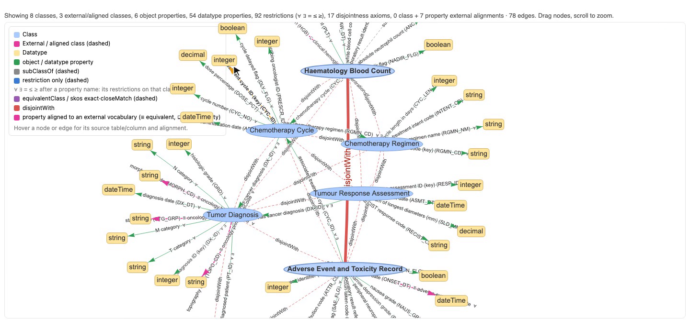

**10. `BM_DEP` now has a meaning.** Every node and edge has a tooltip with its
source table/column and IRI: the `BM_DEP` property is *bone marrow depression
grade*, from column `ae_tox.BM_DEP`.

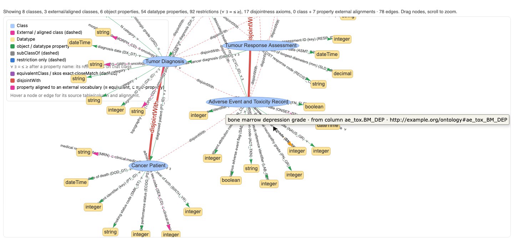

**11. Alignments.** Properties aligned to an external vocabulary are drawn as
pink edges; the tooltip shows the vocabulary term and its full IRI, e.g.
*haemoglobin concentration* from `lab_heme.HGB`, a sub-property of
`clinical:hemoglobinConcentration`. The graph can also be downloaded as a
standalone HTML file.

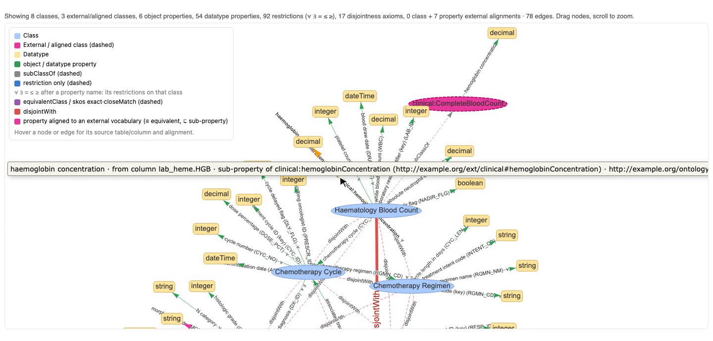

**Other bundled examples:** `examples/northwind/` (the Northwind trading
database, with saved results from Claude and DeepSeek runs) and
`examples/toy_example_1_music_domain/` (a three-table music schema).

## Decision cards

When OOPS! reports a pitfall whose fix could change domain meaning, the app
shows one card per finding (up to five; the rest are listed in the repair
report). Each card has the evidence (OOPS! scope, LLM assessment, affected
terms, proposed triples under *Review details*), the LLM-suggested axioms to
approve individually, and the decision itself. Every accepted change is
re-validated with HermiT and OOPS! before the reviewed ontology is written.

| Variable | Default | Effect |
|---|---|---|
| `RIGOR_PAIR_PICKER` | `1` | Class-pair picker on P10/P30 cards. Set `0` to hide it. |
| `RIGOR_SIMPLE_DECISIONS` | `0` | Set `1` for a compact view: only the first card, as plain text with at most 8 suggested axioms; the other findings stay unresolved. |

The cards are created fresh for each result. An earlier version revealed
pre-built hidden cards, which froze Chrome for minutes with Gradio 6.17
(`RangeError: Set maximum size exceeded` in the console); that no longer
happens, so the picker is on by default again.

## Requirements & limitations

- **External alignment** requires uploading **external ontologies** under
  *Optional context*. Without them, no alignments are produced. Even with them,
  alignment is **best-effort**: the model may align only some classes or
  properties, and coverage varies by model and by what retrieval surfaces.
- **Logical consistency** (HermiT/ROBOT) requires **Java on PATH** plus
  `HermiT.jar` and `robot.jar`. If any are missing, the stage is skipped.
- **OOPS! pitfall detection** uses the public OOPS! service by default (network
  access, no OOPS API key) or a local one from `oops_local/`. If OOPS! is
  unreachable, runs continue with cached OOPS! results and local checks. Deterministic repairs do not require
  an OpenRouter key, while LLM-assisted proposals do. Repairs that may change
  domain meaning always require user confirmation.
- Without an **API key**, generation falls back to deterministic Direct Mapping.
  Syntax checks and deterministic validation/repair stages can still run even if syntax checks are disabled.

## Behavior with missing optional inputs

Only the **schema (CSV or JSON)** is required. Every other input is optional,
and the app degrades gracefully — it never errors out because something is
absent; it just skips the part that needs it and logs it.

| Missing input | What happens |
|---|---|
| **OpenRouter API key** | Generation uses **deterministic Direct Mapping only**. You still get a structurally complete ontology, but no Gen-LLM enrichment, Judge step, or LLM-assisted alignment/repair. Syntax checks, OOPS! detection, and enabled deterministic fixes can still run when their other requirements are available. |
| **External ontologies** | No alignment is produced, and no external retrieval happens. Everything else runs normally; the ontology simply has no `equivalentClass` / `subClassOf` / `subPropertyOf` links to outside vocabularies. |
| **Documents** | No document retrieval. Enrichment proceeds from the schema (and the seed core ontology, if provided) without extra textual context. |
| **Seed core ontology** | The run starts from an empty core and builds entirely from the schema — this is the normal case. |
| **Java / `HermiT.jar` / `robot.jar`** | The logical-consistency stage is **skipped** with a message; the ontology passes through unchanged. (Note: even with the jars, the consistency *repair* loop needs the API key — without a key it can report issues but not fix them.) |
| **Network access** | **OOPS!** detection falls back to cached OOPS! results and local pitfall checks (or use the local OOPS! in `oops_local/`). Any LLM calls also fail, so without network the run behaves much like the no-key case: Direct Mapping, syntax validation, and offline consistency still run. The graph view works offline (vis-network ships in `assets/`). |

In short: with no API key you get a valid deterministic baseline; each optional
input enables another layer of enrichment, validation, or repair.

## Adding models to the dropdown

The model dropdown is built from `MODEL_CHOICES` in `rigor_app.py`:

```python
MODEL_CHOICES = list(dict.fromkeys(list(MODELS.values()) + ["deepseek/deepseek-chat", "openai/gpt-4o"]))
```

There are two ways to add options, and the list is de-duplicated automatically:

1. **Permanent / shared defaults** — add the OpenRouter model id to the `MODELS`
   dict in `app.py`, e.g.:

   ```python
   MODELS = {
       "claude":   "anthropic/claude-opus-4-6",
       "mistral":  "mistralai/mistral-small-24b-instruct-2501",
       "deepseek": "deepseek/deepseek-chat",
       "gpt5":     "openai/gpt-5.4",        # <-- new entry
   }
   ```

   It then appears in the dropdown automatically (the UI reads `MODELS.values()`).

2. **App-only extras** — append the id to the tail list in `MODEL_CHOICES`
   in `rigor_app.py`:

   ```python
   MODEL_CHOICES = list(dict.fromkeys(
       list(MODELS.values()) + ["deepseek/deepseek-chat", "openai/gpt-4o", "openai/gpt-5.4"]
   ))
   ```

The dropdown preselects `google/gemini-3.8-flash` (fast and low-cost); change
`DEFAULT_UI_MODEL` in `rigor_app.py` to preselect another entry.

Use the exact OpenRouter model string (`provider/model-id`). The dropdown also
accepts custom values typed at runtime (`allow_custom_value=True`), so you can
test an id without editing code first.

## API key handling

Your OpenRouter key is held **only in memory for the current session**. It is
never written to disk and never logged. Closing the app discards it.

## What runs, in order

1. RIGOR enrichment — deterministic Direct Mapping merged first (guaranteed
   schema coverage), then per-table LLM enrichment validated by a Judge-LLM.
   On rejection the issues are returned to the Gen-LLM for up to *k* retries
   (default 2); if still rejected, the Judge-LLM selects the best candidate
   between the corrected fragment and the deterministic mapping.
2. Syntax validation + rdflib repair (full ontology).
3. Logical consistency check + repair (HermiT/ROBOT) — skipped if Java/jars
   are unavailable.
4. OOPS! Critical/Important pitfall detection and safe automatic repair.
   Detection uses the public OOPS! service; LLM-assisted proposals require the
   OpenRouter key.
5. Focused user decisions for semantic repairs, followed by validation of each
   selected change.
6. Final validation, then export of the ontology and decision report.

## Environment variables

All are optional; the app works with sensible defaults.

| Variable | Default | Purpose |
|---|---|---|
| `OPENROUTER_API_KEY` | _(unset)_ | OpenRouter key. Usually set from the UI field instead (in-memory only). |
| `RIGOR_MODEL` | `deepseek/deepseek-chat` | Default model id. The UI overrides this per run. |
| `RIGOR_LLM_MAX_TOKENS` | `8000` | Caps the completion tokens reserved per OpenRouter request. Prevents `402` pre-flight rejections caused by reserving a model's full output ceiling. Lower it (e.g. `4096`) to shrink the reservation further on a tight balance. |
| `RIGOR_DEFAULT_LICENSE` | `https://creativecommons.org/licenses/by/4.0/` | License IRI added to the ontology when the OOPS! stage repairs pitfall **P41** ("no license declared"). Set it to the license that actually applies to your ontology. |
| `RIGOR_PAIR_PICKER` | `1` | Show the class-pair picker on P10/P30 decision cards (`0` hides it). |
| `RIGOR_SIMPLE_DECISIONS` | `0` | Compact decision view: first card only (see *Decision cards*). |
| `RIGOR_VIZ_PALETTE` | _(default palette)_ | Set to `cb` (or `colorblind`) to render the graph with the colorblind-safe Okabe-Ito palette. The legend updates to match. |
| `OOPS_ENDPOINT` | `https://oops.linkeddata.es/rest` | OOPS! REST service. Override to point at a self-hosted instance; `unset` to fall back to the public one. |

Example:

```bash
export RIGOR_LLM_MAX_TOKENS=4096
export RIGOR_DEFAULT_LICENSE="https://opensource.org/licenses/Apache-2.0"
export RIGOR_VIZ_PALETTE=cb
python rigor_app.py
```

## OOPS! service endpoint

The OOPS! stage calls a REST service. By default it uses the public instance at
`https://oops.linkeddata.es/rest` — no configuration needed. Outbound network
access is required, so a corporate firewall or VPN may block it; if the public
endpoint stalls or resets, try a different network (e.g. a phone hotspot).

The `OOPS_ENDPOINT` environment variable overrides the default if you ever need
to point at a different instance (e.g. a self-hosted one). Most users won't set
it. To fall back to the public service, clear it: `unset OOPS_ENDPOINT`.

**Run OOPS! locally (recommended for demos).** `oops_local/` builds the OOPS!
authors' Docker image (`mpovedavillalon/oops`) with the WordNet 3.0 files it
needs but does not ship. It then answers in about a second with no
dependence on the public server. With Docker running:

```bash
./oops_local/start_oops.sh
OOPS_ENDPOINT=http://localhost:8080/OOPS/rest python rigor_app.py
```

The first run downloads about 140 MB. Stop it with `docker rm -f rigor-oops`.

**When OOPS! is unreachable.** The app does not hang or drop the stage:

- Each successful OOPS! response is cached on disk, keyed by ontology content
  (`~/.cache/rigor_oops`; override with `RIGOR_OOPS_CACHE_DIR`, or set it empty
  to disable). Re-checking an ontology OOPS! has already seen needs no network.
- After a failure, OOPS! is not retried for `OOPS_COOLDOWN_SECONDS` (300), so an
  outage costs one timeout, not one per repair candidate.
- Detection falls back to local checks (P11, P25, P26, P34, P35, P38, P39, P41),
  and their deterministic fixes are verified locally. User-approved decisions
  are still checked by HermiT and the structural guards.
- **Settings → Check OOPS! connection** (also printed at startup) tells you
  whether the live service is reachable.

| Variable | Default | Purpose |
|---|---|---|
| `OOPS_CONNECT_TIMEOUT` | `10` | Seconds to wait for a connection. |
| `OOPS_READ_TIMEOUT` | `120` | Seconds to wait for an analysis; a read timeout is not retried. |
| `OOPS_RETRIES` | `3` | Attempts on connection errors, HTTP 5xx, or 429. |
| `OOPS_COOLDOWN_SECONDS` | `300` | How long to skip OOPS! after a failure. |
| `RIGOR_OOPS_CACHE_DIR` | `~/.cache/rigor_oops` | On-disk OOPS! response cache. |

**Troubleshooting:** repeated `Connection refused` (e.g. to `localhost:8080`)
during the OOPS! stage usually means `OOPS_ENDPOINT` is set to an instance that
isn't reachable. Check it with `echo "$OOPS_ENDPOINT"`; if it's set
unexpectedly, `unset OOPS_ENDPOINT` (and remove it from your shell profile if
you exported it there), then relaunch.

## Notes

- Without an API key, generation runs in deterministic Direct-Mapping mode;
  enabled syntax checks, OOPS! detection, and deterministic fixes may still run.
- The graph is drawn with vis-network, inlined from `assets/vis-network.min.js`,
  so it renders without internet access (a CDN copy is used only if that file is
  missing). Property edges show the source column next to the label, e.g.
  *bone marrow depression grade (BM_DEP)*; properties aligned to an external
  vocabulary are drawn as pink edges labelled with the vocabulary term; hover any
  node or edge for its source table/column and IRI.
- The Turtle preview is shown as plain text (Turtle has no dedicated syntax
  highlighter in the UI's code component).
- Intermediate artifacts are written to a per-run temp folder for debugging.
  Folders older than six hours are cleared when a new run starts (never one that
  is still in use), and the app removes its own folders when it exits.

## Contact

For inquiries, feel free to contact:
[nadeen.fathallah@ki.uni-stuttgart.de](mailto:nadeen.fathallah@ki.uni-stuttgart.de)

## 📜 License

The sample data and generated ontologies in this repository are licensed under a
[Creative Commons Attribution 4.0 International License](https://creativecommons.org/licenses/by/4.0/).
Code in this repository is licensed under the MIT License.


## 📋 [Read our main paper](https://arxiv.org/pdf/2506.01232?)
## 📋 [Read our demo paper](https://github.com/NadeenAhmad/RIGOR_APP/blob/main/paper_599.pdf)

## 📄 Citation

If you find this work useful, please consider citing our paper:

```
@inproceedings{Fathallah2026RIGOR,
  author    = {Nadeen Fathallah and
               Mojtaba Nayyeri and
               Steffen Staab},
  title     = {RIGOR App: A Demo System for Retrieval-Augmented Generation of Ontologies from Relational Databases},
  booktitle = {ISWC (Industry/Doctoral Consortium/Posters/Demos)},
  year      = {2026}
}
