<p align="center">
  
</p>

# RIGOR App

**RIGOR** (*Retrieval-augmented Iterative Generation of RDB Ontologies*) is an
LLM-driven approach that turns relational database schemas into rich OWL 2 DL
ontologies with minimal human effort. Rather than requiring an engineer to model
an ontology by hand, or settling for the bare structure, a direct mapping
produces — RIGOR combines three sources through Retrieval-Augmented Generation
(RAG): the database schema together with its documentation, a repository of
existing domain ontologies, and a growing *core* ontology. It prompts a
generative LLM to produce successive, provenance-tagged "delta" fragments; each
fragment is checked by a judge-LLM before being merged, and the process iterates
table-by-table following foreign-key constraints until the schema is fully
covered.

This repository is the **companion application**: a Gradio interface around the
RIGOR pipeline. You upload a table (CSV) or a SQL schema (JSON), optionally add
documents, a seed core ontology, and external vocabularies, then run enrichment
followed by syntax, consistency, and OOPS! validation. Safe repairs are applied
automatically; semantic changes are presented for user confirmation before the
reviewed ontology and decision report are exported. The app can also validate
and repair an existing RDF/OWL ontology. It is designed to run **locally for a
single user**. For the method and evaluation, see the paper linked at the end of
this README.

## [Demo Video Link](https://drive.google.com/drive/folders/1XsPji18kmX4gMaap6TjGUOzxE53Gi3dW?usp=sharing)

## Install

Use **Python ≤ 3.12** (PyTorch has no wheels for 3.13+ yet, and none for Intel
macOS past Torch 2.2.2). The simplest reliable setup is a Python 3.12 venv:

```bash
python3.12 -m venv .venv
source .venv/bin/activate
pip install -U pip
pip install -r requirements.txt
```

`requirements.txt` includes the full RIGOR stack (sentence-transformers, faiss,
torch) plus Gradio. The torch line is pinned per architecture automatically:
torch 2.2.2 on Intel macOS, any recent torch elsewhere.

For the **logical-consistency** stage, you also need Java on your PATH (JDK/JRE
**11+**, which covers both ROBOT and HermiT) plus two jars:

- `HermiT.jar`
- `robot.jar` (ROBOT)

Confirm Java works with `java -version`. The jars are picked up automatically
if they sit in the working directory (or next to `rigor_app.py`); otherwise,
enter their paths in the UI. Detection vs. repair:

- HermiT deterministic fixes and ROBOT reasoning run **without** an API key.
- The actual inconsistency *repair* loop calls the LLM, so it only fixes
  things when an OpenRouter key is set.

If Java or a jar is missing, the stage is skipped with a clear message, and the
ontology is passed through unchanged.

The logo shown in the header is loaded from `rigor_logo.png` next to
`rigor_app.py`; keep the two files together. If the image is missing, the app
falls back to a plain text title.

## Run

```bash
python rigor_app.py
```

Then open the printed local URL. This app is intended to run **locally for a
single user**; it is not hardened for shared multi-user hosting (the API key
and models are held in session memory, not isolated per user).

## Using the app

1. **Upload** a CSV (types are inferred and a schema is synthesized) or a SQL
   schema JSON.
2. Review the **summary**: rows, columns, detected types, missing values, a
   preview, and any warnings (e.g., no primary key detected).
3. In **Settings**, paste your OpenRouter API key, pick a model, and enable the
   required validation stages.
4. Click **Run pipeline**. Progress streams live with elapsed time and a coarse
   percentage indicator. **Stop** returns control immediately; an in-flight
   model call may finish in the background.
5. If semantic pitfalls remain, review the focused decision cards, approve or
   reject individual axioms, and click **Apply selected decisions**.
6. **Download** the final or reviewed ontology, inspect the validation report,
   expand the Turtle preview, or render the interactive graph.

To repair an ontology without generating one from a schema, use the
**Repair the existing ontology** section and upload a supported RDF/OWL file.

## Example walkthrough

A complete run on the bundled **music** sample — a small `artist` / `album` /
`track` schema, three description documents, and two external vocabularies
(music + commerce). The screenshots below live in a `screenshots/` folder at
the repository root; if you cloned without it, drop the ten PNGs there so the
images resolve.

**1. Landing page.** The header, then *Settings*: OpenRouter API key, model,
correction retries (k), the validation toggles (logical consistency, Repair
Critical pitfalls, and Repair Important pitfalls), and optional jar paths.

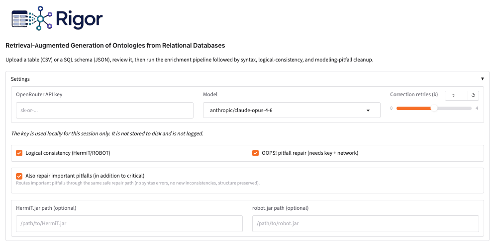

**2. Optional context (advanced).** Three independent, all-optional upload
zones: a seed core ontology to grow, supporting documents for retrieval, and
external ontologies to align with. Leaving any of these empty simply disables
the corresponding behavior (see *Behavior with missing optional inputs*).

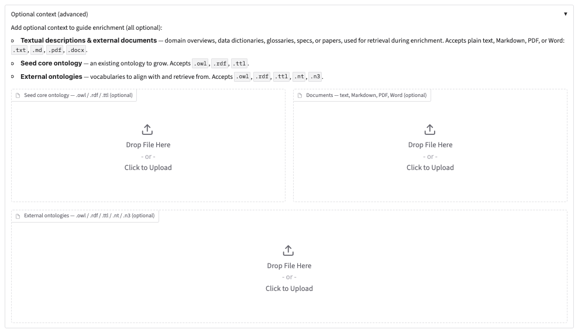

**3. Schema input.** The main drop zone accepts a CSV (types are inferred) or a
SQL schema JSON.

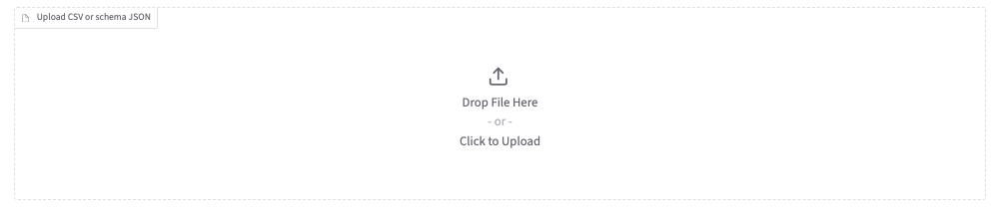

**4. Settings filled in.** An OpenRouter key is entered (masked) and a model is
selected. The key is held in memory for the session only.

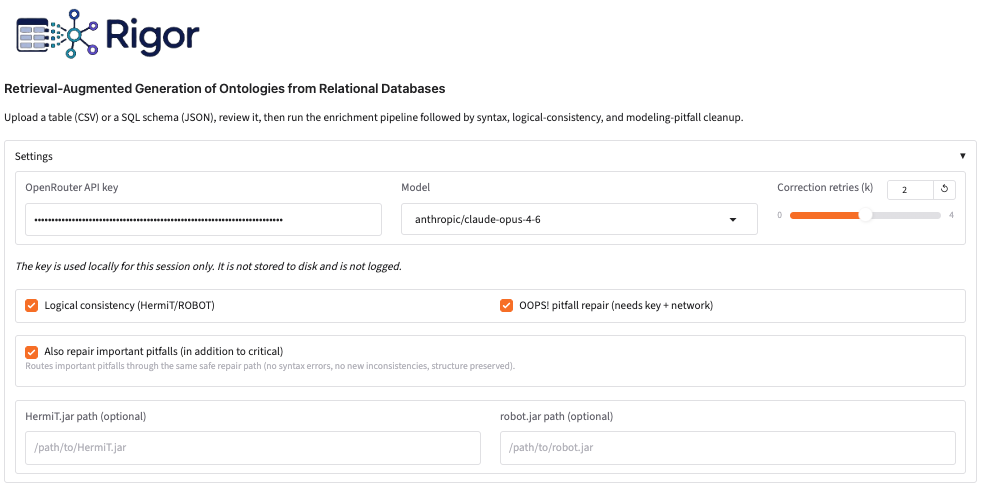

**5. Context loaded and schema summarized.** Three documents
(`sample_docs_music_*.md`) and two external ontologies
(`sample_ext_commerce.ttl`, `sample_ext_music.ttl`) are uploaded, plus
`sample_schema.json`. *Summarize table* reports the detected input as a schema
JSON with three tables — `artist` (PK `artist_id`), `album` (PK `album_id`,
1 FK), `track` (PK `track_id`, 1 FK) — and **No obvious issues detected**.

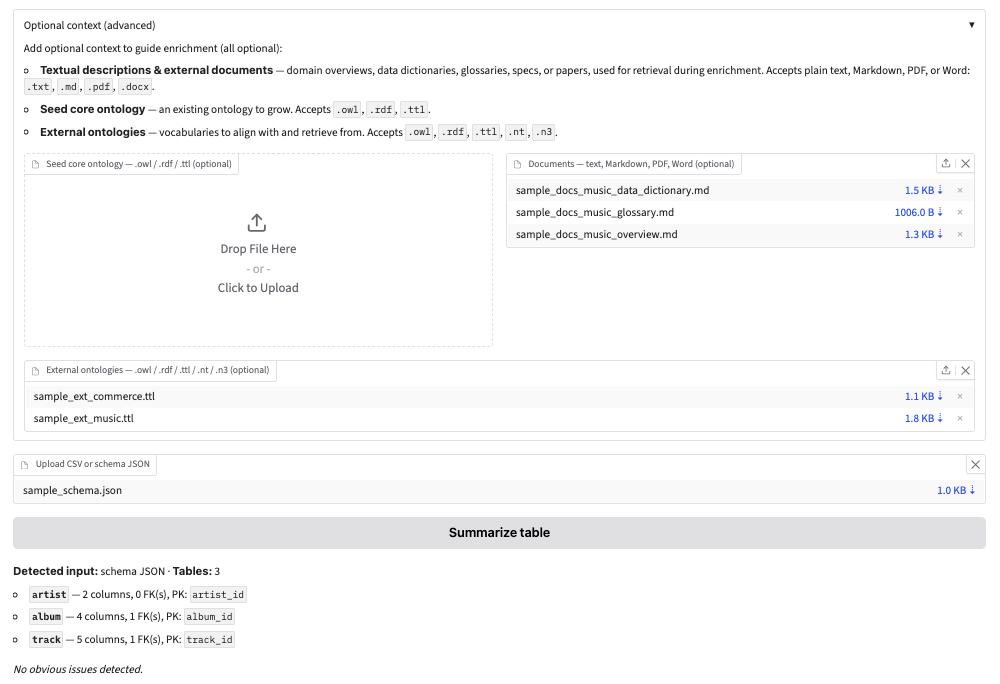

**6. Run started.** Clicking *Run pipeline* streams progress live; the elapsed
timer is visible in the corner.

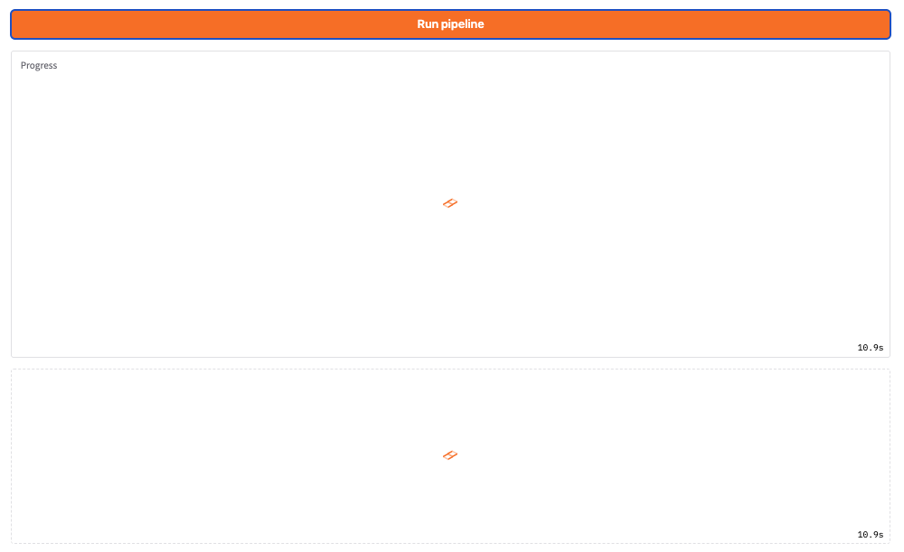

**7. Early progress.** The jars are auto-detected, the schema loads (3 tables),
the local embedding model (`all-MiniLM-L6-v2`) is initialized, and the two FAISS
indexes are built — 5 document chunks and 12 external-ontology chunks.

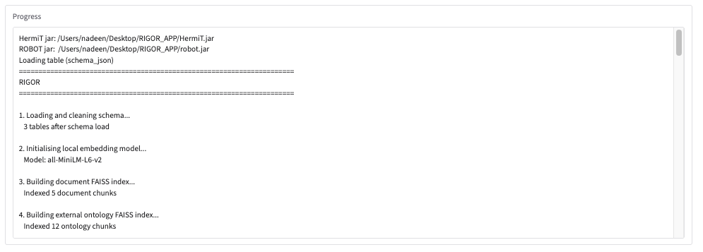

**8. Finishing up.** The OOPS! repair loop applies safe fixes and queues any
semantic findings that need confirmation. After final validation, the generated
ontology (`sample_schema_final_ontology.owl`) is offered for download.

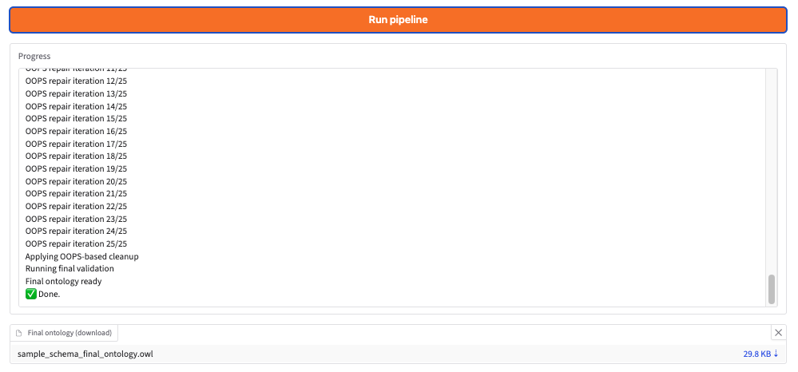

**9. Turtle preview.** The generated ontology with prefixes, an `owl:Ontology`
node carrying `prov:generatedAtTime`, the external `music#MusicAlbum` class, the
aligned `releaseDate` / `releasedBy` properties, and a `track_hasAlbum` object
property with a label, comment, and `prov:wasDerivedFrom` provenance back to the
originating foreign key.

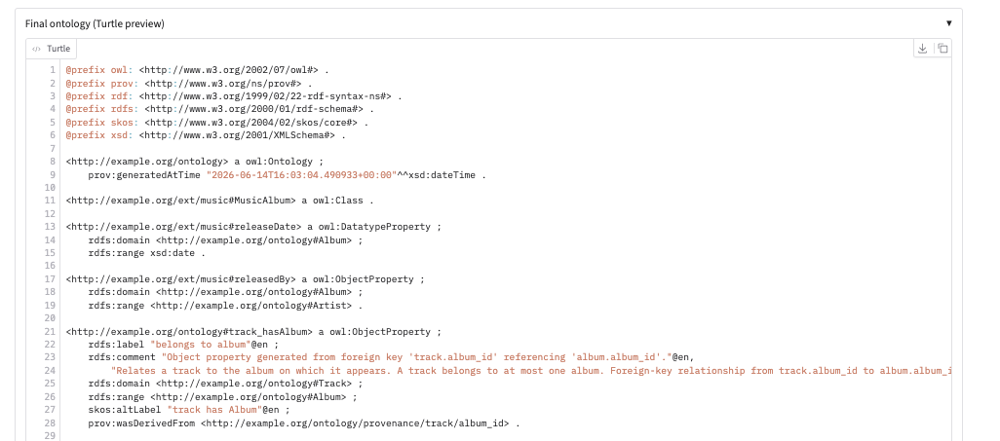

**10. Focused semantic review (when needed).** For pitfalls that can change
domain meaning, the app shows pitfall-specific choices instead of applying a
silent fix. Users may approve selected axioms, add alternatives from ontology
entities, reject the proposal, or leave it unresolved. Accepted changes are
revalidated before a separate reviewed ontology and decision report are made
available.
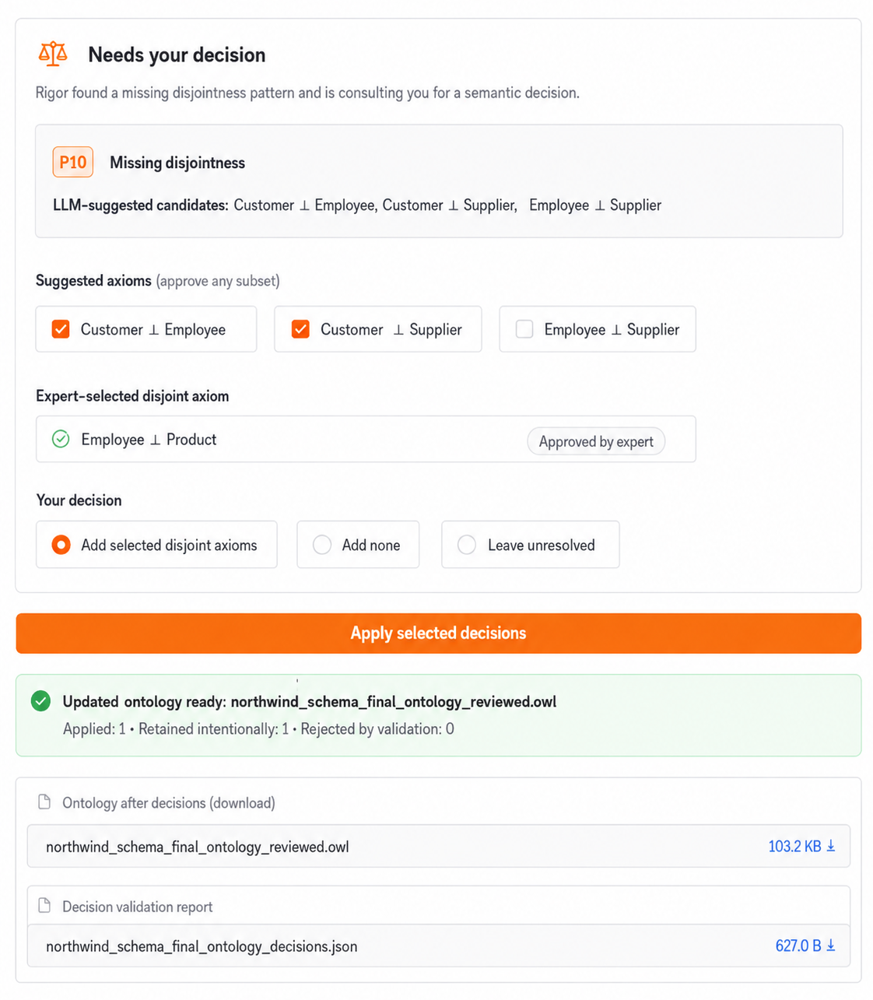

**11. Visualization.** The WebVOWL-style graph. `Album` links by `subClassOf`
to the external `MusicAlbum` node (shown in the distinct external color), three
property alignments appear as edge labels, and the legend plus the summary line
(classes, properties, restrictions, disjointness, external alignments, edges)
describe the rest. You can also download the graph as a standalone HTML.

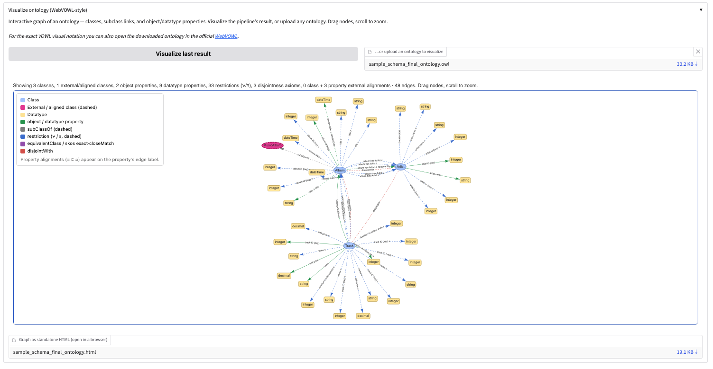


## Requirements & limitations

- **External alignment** requires uploading **external ontologies** under
  *Optional context*. Without them, no alignments are produced. Even with them,
  alignment is **best-effort**: the model may align only some classes or
  properties, and coverage varies by model and by what retrieval surfaces.
- **Logical consistency** (HermiT/ROBOT) requires **Java on PATH** plus
  `HermiT.jar` and `robot.jar`. If any are missing, the stage is skipped.
- **OOPS! pitfall detection** uses the public OOPS! service and therefore needs
  network access; there is no OOPS API key. Deterministic repairs do not require
  an OpenRouter key, while LLM-assisted proposals do. Repairs that may change
  domain meaning always require user confirmation.
- Without an **API key**, generation falls back to deterministic Direct Mapping.
  Syntax checks and deterministic validation/repair stages can still run even if syntax checks are disabled.

## Behavior with missing optional inputs

Only the **schema (CSV or JSON)** is required. Every other input is optional,
and the app degrades gracefully — it never errors out because something is
absent; it just skips the part that needs it and logs it.

| Missing input | What happens |
|---|---|
| **OpenRouter API key** | Generation uses **deterministic Direct Mapping only**. You still get a structurally complete ontology, but no Gen-LLM enrichment, Judge step, or LLM-assisted alignment/repair. Syntax checks, OOPS! detection, and enabled deterministic fixes can still run when their other requirements are available. |
| **External ontologies** | No alignment is produced, and no external retrieval happens. Everything else runs normally; the ontology simply has no `equivalentClass` / `subClassOf` / `subPropertyOf` links to outside vocabularies. |
| **Documents** | No document retrieval. Enrichment proceeds from the schema (and the seed core ontology, if provided) without extra textual context. |
| **Seed core ontology** | The run starts from an empty core and builds entirely from the schema — this is the normal case. |
| **Java / `HermiT.jar` / `robot.jar`** | The logical-consistency stage is **skipped** with a message; the ontology passes through unchanged. (Note: even with the jars, the consistency *repair* loop needs the API key — without a key it can report issues but not fix them.) |
| **Network access** | The **OOPS!** stage is skipped (it calls a remote service). Any LLM calls also fail, so without network the run behaves much like the no-key case: Direct Mapping, syntax validation, and offline consistency still run. |

In short: with no API key you get a valid deterministic baseline; each optional
input enables another layer of enrichment, validation, or repair.

## Adding models to the dropdown

The model dropdown is built from `MODEL_CHOICES` in `rigor_app.py`:

```python
MODEL_CHOICES = list(dict.fromkeys(list(MODELS.values()) + ["deepseek/deepseek-chat", "openai/gpt-4o"]))
```

There are two ways to add options, and the list is de-duplicated automatically:

1. **Permanent / shared defaults** — add the OpenRouter model id to the `MODELS`
   dict in `app.py`, e.g.:

   ```python
   MODELS = {
       "claude":   "anthropic/claude-opus-4-6",
       "mistral":  "mistralai/mistral-small-24b-instruct-2501",
       "deepseek": "deepseek/deepseek-chat",
       "gpt5":     "openai/gpt-5.4",        # <-- new entry
   }
   ```

   It then appears in the dropdown automatically (the UI reads `MODELS.values()`).

2. **App-only extras** — append the id to the tail list in `MODEL_CHOICES`
   in `rigor_app.py`:

   ```python
   MODEL_CHOICES = list(dict.fromkeys(
       list(MODELS.values()) + ["deepseek/deepseek-chat", "openai/gpt-4o", "openai/gpt-5.4"]
   ))
   ```

Use the exact OpenRouter model string (`provider/model-id`). The dropdown also
accepts custom values typed at runtime (`allow_custom_value=True`), so you can
test an id without editing code first.

## API key handling

Your OpenRouter key is held **only in memory for the current session**. It is
never written to disk and never logged. Closing the app discards it.

## What runs, in order

1. RIGOR enrichment — deterministic Direct Mapping merged first (guaranteed
   schema coverage), then per-table LLM enrichment validated by a Judge-LLM.
   On rejection the issues are returned to the Gen-LLM for up to *k* retries
   (default 2); if still rejected, the Judge-LLM selects the best candidate
   between the corrected fragment and the deterministic mapping.
2. Syntax validation + rdflib repair (full ontology).
3. Logical consistency check + repair (HermiT/ROBOT) — skipped if Java/jars
   are unavailable.
4. OOPS! Critical/Important pitfall detection and safe automatic repair.
   Detection uses the public OOPS! service; LLM-assisted proposals require the
   OpenRouter key.
5. Focused user decisions for semantic repairs, followed by validation of each
   selected change.
6. Final validation, then export of the ontology and decision report.

## Environment variables

All are optional; the app works with sensible defaults.

| Variable | Default | Purpose |
|---|---|---|
| `OPENROUTER_API_KEY` | _(unset)_ | OpenRouter key. Usually set from the UI field instead (in-memory only). |
| `RIGOR_MODEL` | `deepseek/deepseek-chat` | Default model id. The UI overrides this per run. |
| `RIGOR_LLM_MAX_TOKENS` | `8000` | Caps the completion tokens reserved per OpenRouter request. Prevents `402` pre-flight rejections caused by reserving a model's full output ceiling. Lower it (e.g. `4096`) to shrink the reservation further on a tight balance. |
| `RIGOR_DEFAULT_LICENSE` | `https://creativecommons.org/licenses/by/4.0/` | License IRI added to the ontology when the OOPS! stage repairs pitfall **P41** ("no license declared"). Set it to the license that actually applies to your ontology. |
| `RIGOR_VIZ_PALETTE` | _(default palette)_ | Set to `cb` (or `colorblind`) to render the graph with the colorblind-safe Okabe-Ito palette. The legend updates to match. |
| `OOPS_ENDPOINT` | `https://oops.linkeddata.es/rest` | OOPS! REST service. Override to point at a self-hosted instance; `unset` to fall back to the public one. |

Example:

```bash
export RIGOR_LLM_MAX_TOKENS=4096
export RIGOR_DEFAULT_LICENSE="https://opensource.org/licenses/Apache-2.0"
export RIGOR_VIZ_PALETTE=cb
python rigor_app.py
```

## OOPS! service endpoint

The OOPS! stage calls a REST service. By default it uses the public instance at
`https://oops.linkeddata.es/rest` — no configuration needed. Outbound network
access is required, so a corporate firewall or VPN may block it; if the public
endpoint stalls or resets, try a different network (e.g. a phone hotspot).

The `OOPS_ENDPOINT` environment variable overrides the default if you ever need
to point at a different instance (e.g. a self-hosted one). Most users won't set
it. To fall back to the public service, clear it: `unset OOPS_ENDPOINT`.

**Troubleshooting:** repeated `Connection refused` (e.g. to `localhost:8080`)
during the OOPS! stage usually means `OOPS_ENDPOINT` is set to an instance that
isn't reachable. Check it with `echo "$OOPS_ENDPOINT"`; if it's set
unexpectedly, `unset OOPS_ENDPOINT` (and remove it from your shell profile if
you exported it there), then relaunch.

## Notes

- Without an API key, generation runs in deterministic Direct-Mapping mode;
  enabled syntax checks, OOPS! detection, and deterministic fixes may still run.
- The Turtle preview is shown as plain text (Turtle has no dedicated syntax
  highlighter in the UI's code component).
- Intermediate artifacts are written to a per-run temp folder for debugging.
  The previous run's temp folder is cleared when a new run starts, and the whole
  scratch area is removed when the app exits.

## Contact

For inquiries, feel free to contact:
[nadeen.fathallah@ki.uni-stuttgart.de](mailto:nadeen.fathallah@ki.uni-stuttgart.de)

## 📜 License

The sample data and generated ontologies in this repository are licensed under a
[Creative Commons Attribution 4.0 International License](https://creativecommons.org/licenses/by/4.0/).
Code in this repository is licensed under the MIT License.


